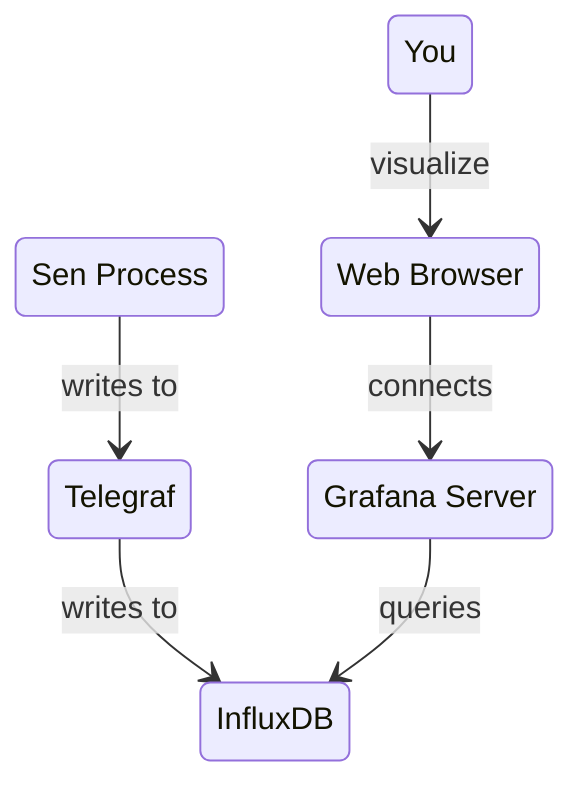

# The Influx component

{: style="width:120px"}

With Sen, you can use Grafana and InfluxDB to visualize the data that runs through your system.

{: style="width:1200px;"}

It works as follows:

1. Your Sen process sends the data to another process called
   [Telegraf](https://www.influxdata.com/time-series-platform/telegraf/).
2. [Telegraf](https://www.influxdata.com/time-series-platform/telegraf/) sends the data to a
   time-series database called [InfluxDB](https://www.influxdata.com/db/).
3. [InfluxDB](https://www.influxdata.com/db/) is then queried by a process called
   [Grafana](https://www.grafana.com), which is a web server.
4. You connect to the [Grafana](https://www.grafana.com) server using your web browser.



These monitoring and visualization systems (Telegraf, InfluxDB, Grafana) can be combined in many
ways. They are designed to be composable and really scalable. The price to pay is that you have to
set up your InfluxDB server, execute the Telegraf server, ensure that they are connected, and then
connect Grafana to InfluxDB. Hopefully, this is something that only happens once.

The configuration and usage of these 3rd-party tools are out of the scope of this document, but
thankfully there is plenty of information available on the web, and a large community of open-source
and commercial users.

Once the data is stored in InfluxDB, you can access it anytime. Maybe you can find other uses, and
connect other tools to do your analytics.

The Sen `influx` [component](../users_guide/glossary.md#component) sends the data to Telegraf over
any of the schemes its listeners accept: TCP, UDP, a Unix socket, or HTTP.

## Running the Influx component

The configuration parameters are:

```rust title="Influx configuration options"
--8<-- "snippets/influx_config.stl"
```

For example, you can run a Sen process and tell the `influx` component to forward all the objects in
a given bus:

```yaml title="Example hello_influx.yaml"
load:
  - name: influx
    group: 3
    transport:
      type: Tcp
      value:
        address: 127.0.0.1
        port: 8095
    batchSize: 32
    selections:
      - SELECT * FROM school.primary
```

### Choosing a transport

`transport` names one of the schemes Telegraf's socket listener accepts, with the parameters that
scheme needs. Each one has to match the listener's own `service_address`:

| `type` | Telegraf's `service_address` | Kind |
| ------ | ---------------------------- | ---- |
| `Tcp`  | `tcp://<address>:<port>`     | stream |
| `Tcp4` | `tcp4://<address>:<port>`    | stream |
| `Tcp6` | `tcp6://[<address>]:<port>`  | stream |
| `Udp`  | `udp://<address>:<port>`     | packet |
| `Udp4` | `udp4://<address>:<port>`    | packet |
| `Udp6` | `udp6://[<address>]:<port>`  | packet |
| `Unix` | `unix:///<path>`             | stream |
| `UnixGram` | `unixgram:///<path>`     | packet |
| `Http` | a `influxdb_listener` input  | request |

The `4` and `6` forms resolve the address in that family alone, so a name with records in both
cannot connect over the other one. `Tcp` and `Udp` take whichever the resolver answers.

`Http` is the one that does not go to `socket_listener`: it posts to Telegraf's `influxdb_listener`
input, which is described under [Posting over HTTP](#posting-over-http) below.

A local Telegraf is reached more cheaply over a socket file than over the loopback interface:

```yaml title="Sending to a Telegraf on the same host"
    transport:
      type: Unix
      value:
        path: /tmp/telegraf.sock
```

Both socket-file transports are built only where asio provides local sockets, which excludes
Windows. On a host without them the component refuses either one while it loads, with a message
naming the alternatives, rather than appearing to record and sending nothing. On Windows, use
`Tcp`, `Udp` or `Http`.

Where they are built, `Unix` dials on its first send as `Tcp` does, so a Telegraf that has not
created its socket yet is not an error. `UnixGram` opens its socket while the component loads.

### Bounding a datagram

The packet transports take `maxMessageSize`, the bytes one datagram may carry. `0` leaves it to the
protocol. A payload over the bound is cut at a line boundary and sent as several datagrams, which
is what compression needs, since its size is only known once it has run.

Without compression, a batch is also flushed before a line would carry it past the bound, so the
cut rarely has anything to do. With compression the batch may hold sixteen times the bound before
it is flushed: holding it to the bound itself would cap the *uncompressed* batch at the size of one
datagram and waste most of the packet, because this line protocol compresses by more than ten
times. So with `maxMessageSize: 1472` and compression on, up to about 23 kB of line protocol is
held before anything leaves, which is what to reason about if you care how old the oldest point in
a batch can be. Neither is a guarantee — a single line longer than the bound cannot be sent at all, and is
reported and dropped — and with `batchSize: 0` there is no batch to flush.

An IPv4 datagram carries at most 65507 bytes and an IPv6 one 65527, so a larger bound is reported.
Neither figure avoids IP fragmentation, which begins near 1472 bytes on a 1500-byte link; set the
bound near there if what you want is one packet per message on the wire.

### Compressing what is sent

The `compression` option gzips each message before it leaves the component. It is a variant, so it
is written with the alternative's name and its value:

```yaml title="Example hello_influx.yaml, with compression"
load:
  - name: influx
    group: 3
    transport:
      type: Tcp
      value:
        address: 127.0.0.1
        port: 8095
    batchSize: 32
    compression:
      type: GZip
      value:
        level: 6
    selections:
      - SELECT * FROM school.primary
```

The level is deflate's own: `-1` for zlib's default, and `0` to `9` otherwise. A level outside that
range stops the component with a message naming it, rather than failing on every send.

Telegraf decodes a compressed payload only when its own socket listener is told to expect one:

```toml title="Telegraf's side"
[[inputs.socket_listener]]
  service_address = "tcp://:8095"
  content_encoding = "gzip"
```

`content_encoding` defaults to `identity`, so a listener left at the default refuses what this
option sends. Telegraf decodes the stream before it splits it into lines, which is why each message
still carries its line separator inside the compressed data.

Compression applies per message, so `batchSize` decides how much goes into each gzip stream. One
point per message compresses poorly; a batch of a few dozen lines is where it begins to pay.

### Posting over HTTP

`Http` posts each message to Telegraf's `influxdb_listener` input instead of a socket listener. It
is the only transport whose answer says whether the batch was accepted; the socket transports
cannot tell a refused batch from an accepted one.

```yaml title="Posting to an influxdb_listener"
    transport:
      type: Http
      value:
        address: 127.0.0.1
        port: 8186
        path: /write
        username: sen
        password: a-secret
```

```toml title="Telegraf's side"
[[inputs.influxdb_listener]]
  service_address = ":8186"
```

`username` and `password` are optional; given, they are sent as basic authentication. `path` is
`/write` when left empty, which is what `influxdb_listener` serves.

The limits are worth knowing before choosing it:

- **An answer is not a verdict.** A 204 means the whole batch was taken. A 400 usually means the
  well-formed lines were taken and the malformed ones were not, and a 503 that the batch was taken
  up to the point the listener stopped — neither is a refusal, and only the reason text the
  listener sends alongside separates them from one. A 413 or a 401 is a clean refusal.
- **No TLS.** The request goes out in the clear, so basic authentication over an untrusted network
  exposes the password. TLS would put OpenSSL into every consumer of Sen, which is a dependency Sen
  deliberately does not carry.
- **No redirects.** A 3xx answer is reported and the batch is dropped; point the configuration at
  the listener itself.
- **Telegraf's own ceiling.** `max_body_size` defaults to 32 MiB and a larger body is refused with
  a 413. It bounds the bytes actually sent, so for a compressed batch it bounds the compressed
  length, and this listener puts no limit on what those bytes expand to. `read_timeout` and
  `write_timeout` both default to 10s. These are the listener's settings, not the component's.
- **An answer is waited for.** Connecting, sending and reading the answer all happen on the cycle
  doing the recording, each under a one-second deadline. An attempt is four such operations — the
  connect, the request, the answer's headers and its body — and a send makes two attempts, so one
  message can delay a cycle by under twelve seconds against a listener that accepts the connection
  and then says nothing. A batch that `maxMessageSize` splits into several messages pays that per
  message. Reporting is outside that figure: the component writes its messages synchronously, so a
  blocked output stream can hold a cycle for longer than any of the deadlines above, which is a
  property of the component rather than of this transport.

  None of this happens in ordinary use: a listener on the same host answers in well under a
  millisecond, and a connection the listener has closed is noticed before the send rather than by
  waiting for an answer. But the socket transports never wait at all, so where no pause is
  acceptable, prefer one of them.
- **A batch is never sent twice.** When the request went out whole and no answer came back, the
  batch is dropped rather than resent, because Telegraf may already hold it. A duplicate is
  invisible in InfluxDB, where the same series and timestamp overwrite each other, but not in a
  Telegraf output that counts what it receives.

## Data model

In InfluxDB, each data point contains the following elements:

- **measurement**: String that identifies the measurement to store the data in.

- **tag set**: Comma-delimited list of key value pairs, each representing a tag.

- **field set**: Comma-delimited list of key value pairs, each representing a field.

- **timestamp**: Unix timestamp associated with the data in nanosecond precision.

They use a "line protocol" that represents a data point in the following format:

```text
measurement,tag1=val1,tag2=val2 field1="v1",field2=1i 0000000000000000000
```

## Mapping from objects to time series

Sen applies the following translation between its object model and Influx's protocol:

- All data points have a tag named `object` containing the name of the object.

- All data points have a tag named `payload_type` containing the type of information contained.
  Possible values are: `event`, `property_change`, `creation` and `deletion`.

- For property changes, the measurement is the qualified name of the class followed by the name of
  the property, as in `school.Student.brainActivity`. The value is stored in the `value` field.

- For events, the measurement is the qualified name of the class followed by the name of the event.
  The arguments (if any) are added as fields, each one named after the argument.

- For creations, the measurement is "created". All property values are added as fields.

- For deletions, the measurement is "deleted". There are no fields.

- When dealing with values of structures, the information is flattened by creating an Influx field
  per structure field. This happens recursively, using dots as separators.

- When dealing with values of variants, there will be an extra ".type" field holding the name of the
  type currently held, and a ".value" field holding the value itself.

- When dealing with enumerations, the field holds the name of the enumerator, and there will be an
  extra ".key" field indicating the numeric value.

## Grafana, InfluxDB, and Telegraf Docker deployment guide

There is a docker image which starts a Grafana web server and all the components needed to receive
and serve the data. The [InfluxDB example](../snippets/examples/config/8_influx/readme.md) builds
and starts it, and walks through connecting Grafana to InfluxDB and building a first dashboard.
